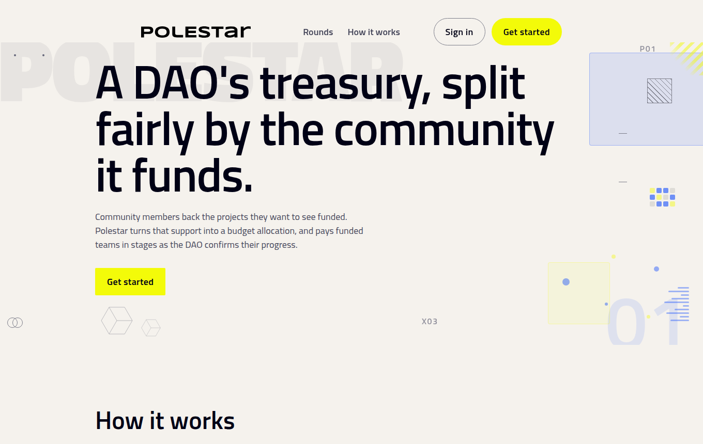
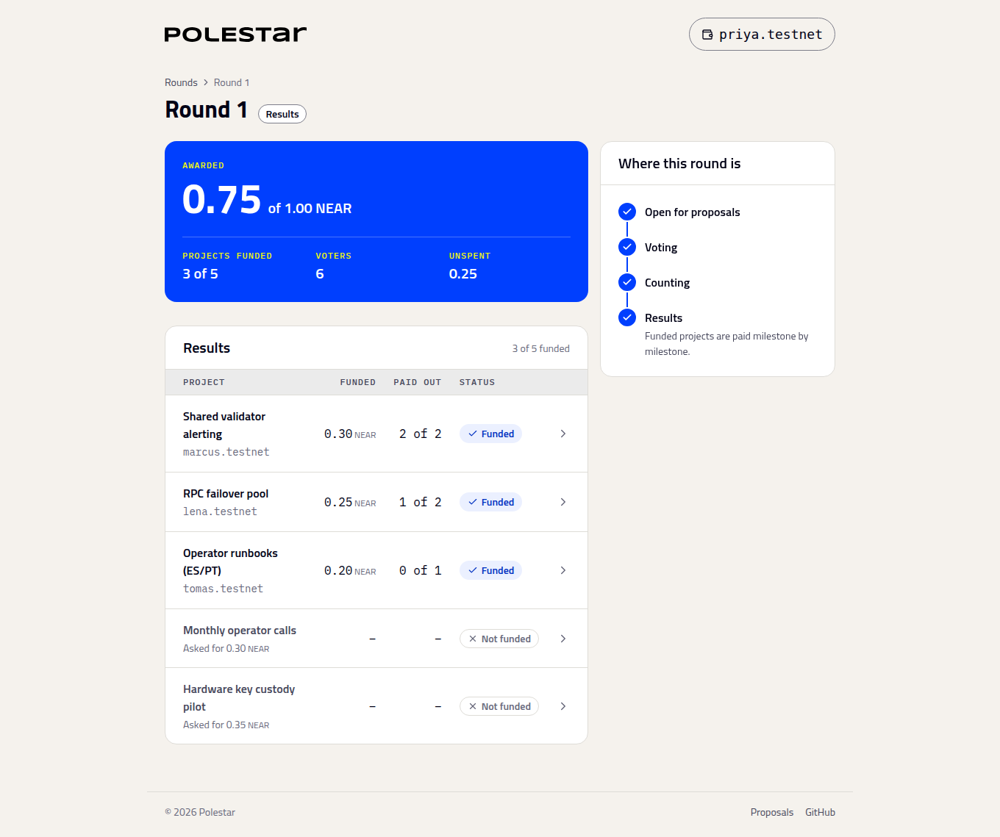

# Polestar

Participatory budgeting for SputnikDAO treasuries on NEAR. A DAO's council approves a budget, the community proposes projects and votes, the budget is split using the Method of Equal Shares, and each project is paid milestone by milestone as the council confirms delivery.



**Documentation:** [docs/](docs/README.md) · **SDK:** [`@ezeonlabs/polestar`](packages/sdk/README.md)

## Live

| | |
| --- | --- |
| [polestar-one.vercel.app](https://polestar-one.vercel.app) | The app, connected to the public testnet deployment. Sign in with a real NEAR wallet. |
| [polestar-demo.vercel.app](https://polestar-demo.vercel.app) | Every role, no wallet: sign in as the council, a proposer, a voter, or an outsider. See the [walkthrough](example/README.md). |

## Prerequisites

- [Node.js](https://nodejs.org/) 20.12 or later
- [Rust](https://rustup.rs/) (stable) and [cargo-near](https://github.com/near/cargo-near): `cargo install --locked cargo-near`
- [NEAR CLI](https://github.com/near/near-cli): `npm install -g near-cli`
- A NEAR account to deploy from (on testnet, fund one from the [faucet](https://near-faucet.io/))

## Quick start

```bash
git clone https://github.com/maelstrom0x8/polestar.git
cd polestar/psui
npm install
npm run dev
```

Open http://localhost:5173. By default the app connects to the public deployment:

| | Account |
| --- | --- |
| Contract | `budgeting.polestar-dev.testnet` |
| SputnikDAO | `dao.polestar-dev.testnet` |

## Deploy your own

Replace `you.testnet` and `mycommunity` with your own names.

**1. Create a SputnikDAO**, or use one you already run:

```bash
ARGS=$(printf '%s' '{"config":{"name":"mycommunity","purpose":"Community budget","metadata":""},"policy":["you.testnet"]}' | base64 | tr -d '\n')

near call sputnik-v2.testnet create "{\"name\":\"mycommunity\",\"args\":\"$ARGS\"}" \
  --accountId you.testnet --deposit 6 --gas 150000000000000
```

**2. Build the contract:**

```bash
cd contracts/budgeting
cargo near build non-reproducible-wasm
cd ../..
```

**3. Deploy and initialize it with your DAO:**

```bash
near create-account budget.you.testnet --masterAccount you.testnet --initialBalance 5

near deploy budget.you.testnet target/near/polestar_budgeting/polestar_budgeting.wasm \
  --initFunction new \
  --initArgs '{"sputnik_dao_account":"mycommunity.sputnik-v2.testnet"}'
```

**4. Fund the DAO's treasury:**

```bash
near send you.testnet mycommunity.sputnik-v2.testnet 3
```

**5. Point the app at your deployment.** Create `psui/.env.local`:

```bash
VITE_CONTRACT_ID=budget.you.testnet
VITE_DAO_ID=mycommunity.sputnik-v2.testnet
```

Then run `npm run dev` in `psui/`.

## Usage

1. **Fund a round.** As a council member, open **Proposals**, choose **Fund a round**, set the budget, timings and who can vote, then **Submit** and **Approve** it. To limit voting to a community, choose **Members of a named account** and enter a name such as `guild.near`: only accounts directly under it, like `priya.guild.near`, can vote.
2. **Register.** Voters open the round and choose **Register as a voter** before registration closes.
3. **Propose.** On the round page, choose **Propose a project** and enter its milestones.
4. **Vote.** Choose **Start voting**. Registered voters then approve the projects they support.
5. **Count.** After voting closes, choose **End voting**, then **Finish counting** to see the results.
6. **Pay.** As a council member, open **Proposals**, choose **Pay a milestone**, then submit and approve it.



The [full walkthrough](docs/getting-started/run-a-first-round.md) has a screenshot of every step.

## Configuration

Set these in `psui/.env.local`:

| Variable | Default |
| --- | --- |
| `VITE_CONTRACT_ID` | `budgeting.polestar-dev.testnet` |
| `VITE_DAO_ID` | `dao.polestar-dev.testnet` |
| `VITE_NEAR_RPC_URL` | `https://test.rpc.fastnear.com` |

## Project structure

| Path | Description |
| --- | --- |
| `contracts/budgeting` | NEAR smart contract |
| `crates/allocate` | Method of Equal Shares allocation engine |
| `crates/math` | Exact rational arithmetic |
| `packages/sdk` | TypeScript SDK for reading rounds and sending transactions ([docs](packages/sdk/README.md)) |
| `psui` | Web app (React, TypeScript, Vite) |
| `docs` | [Documentation](docs/README.md): setup, using Polestar, building on it, and how it works |

## Testing

The allocation engine is checked against an independent Python reference that counts with exact fractions (100 voters, 6 projects), and property tests check it on randomly generated rounds. The sandbox tests deploy the contract and measure counting gas at up to 50 projects and 500 voters.

```bash
cargo test -p math -p allocate
cargo test -p polestar-budgeting --lib
cd packages/sdk && npm install && npm test && cd ../..
cd psui && npm run lint && npm run build
```

Sandbox tests need a contract build first:

```bash
cd contracts/budgeting && cargo near build non-reproducible-wasm && cd ../..
cargo test -p polestar-budgeting --test voter_namespace --test batched_allocation --test return_remaining
cargo test -p polestar-budgeting --test gas_profile -- --nocapture
```

The gas profile takes over 15 minutes.

## License

[Apache-2.0](LICENSE)
