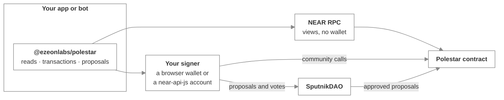

# Building on Polestar

_What you can build on top of Polestar, and where to start_

Polestar is a public contract with a small, stable interface. Everything the web app does, another app, bot or script can do too, through the [`@ezeonlabs/polestar`](sdk.md) SDK or directly against the contract.

## What people build

| You want to | Start with |
| :-- | :-- |
| **Decide who counts as a member.** Give vouched-for members an account under your community's name, so they can vote in members-only rounds. | [Issue members for members-only rounds](members-only-rounds.md) |
| **Keep rounds moving without anyone clicking.** End voting and run the count as soon as a round is ready. | [Run a keeper bot](keeper-bot.md) |
| **Fund rounds on a schedule, or from your own tools.** Prepare funding, payment and return proposals from scripts or another treasury interface. | [Prepare SputnikDAO proposals](sputnikdao-proposals.md) |
| **Show rounds on your own site, or post alerts.** "Voting is open", "results are in", "milestone paid". | [The SDK](sdk.md) and its event parsing |
| **Report on funding.** Turnout, results, payment progress per project. | [The SDK](sdk.md) reads |

## The integration surface

Reading needs nothing but an RPC endpoint. Writing needs a signer. The three DAO operations go through the DAO as proposals, never straight to Polestar.

## Next steps

- [The SDK](sdk.md) — Install it and make your first read
- [Contract reference](../resources/contract-reference.md) — Every method, view, event and error
