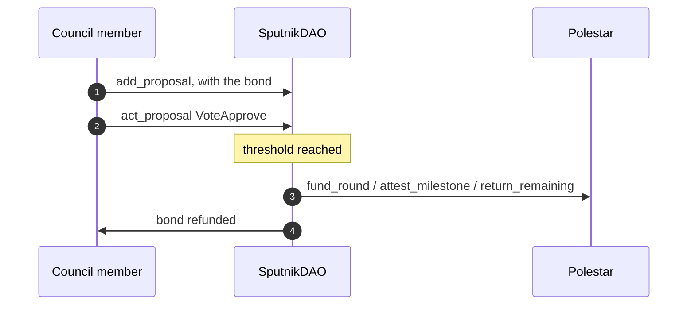

# Prepare SputnikDAO proposals

_The exact proposals behind funding a round, paying a milestone, and returning unspent budget_

The three DAO operations reach Polestar as `FunctionCall` proposals in the DAO's own contract. The [SDK](sdk.md) builds them for you; this page shows the raw shape for anyone building them another way.



1. **A member submits the proposal.** `add_proposal` on the DAO, with the policy's `proposal_bond` attached.
2. **Council members approve it.** `act_proposal` on the DAO, once per member, until the policy's threshold is reached.
3. **The DAO executes it.** The vote that reaches the threshold runs the Polestar call, as the DAO's own account.
4. **The bond comes back.** It's refunded once the proposal is approved or rejected.

## Submitting

The inner action's `args` is the Polestar call's JSON arguments, base64-encoded:

```json
{
  "proposal": {
    "description": "November infrastructure round",
    "kind": {
      "FunctionCall": {
        "receiver_id": "budgeting.polestar-dev.testnet",
        "actions": [
          {
            "method_name": "fund_round",
            "args": "<base64 of the fund_round arguments>",
            "deposit": "2000000000000000000000000",
            "gas": "100000000000000"
          }
        ]
      }
    }
  }
}
```

The `args` payload for that example, before encoding:

```json
{"config":{"budget":2000000000000000000000000,"opens_at":277200000,"closes_at":277650000,"t_min":0},"voter_namespace":"meridian.testnet"}
```

| Operation | `method_name` | `args` before encoding | `deposit` | Gas |
| :-- | :-- | :-- | :-- | :-- |
| Fund a round | `fund_round` | as above; leave out `voter_namespace` for an open round | the budget | 100 Tgas |
| Pay a milestone | `attest_milestone` | `{"round_id":0,"project_id":1,"milestone_index":0}` | `0` | 150 Tgas |
| Return unspent budget | `return_remaining` | `{"round_id":0}` | `0` | 50 Tgas |

**Note**

`fund_round` takes the budget as a bare JSON integer, and the action's `deposit` must equal it exactly. Encode the arguments as exact bytes: a JSON library that turns `budget` into a floating-point number will change it.

## Approving

Council members vote with `act_proposal`, echoing the proposal's `kind` exactly as the DAO stored it, so a vote can't land on a proposal that changed:

```json
{ "id": 42, "action": "VoteApprove", "proposal": { "FunctionCall": { "…": "as returned by get_proposal" } }, "memo": null }
```

Attach 300 Tgas, so there's room for the Polestar call if this vote is the one that reaches the threshold.

## Finding Polestar proposals

`get_last_proposal_id` and `get_proposals({ from_index, limit })` list the DAO's proposals. Polestar's are the `InProgress` ones whose `FunctionCall.receiver_id` is the Polestar contract. Because they're ordinary SputnikDAO proposals, any SputnikDAO interface can show and approve them.

## Next steps

- [Contract reference](../resources/contract-reference.md) — Every argument and refusal for the three calls
