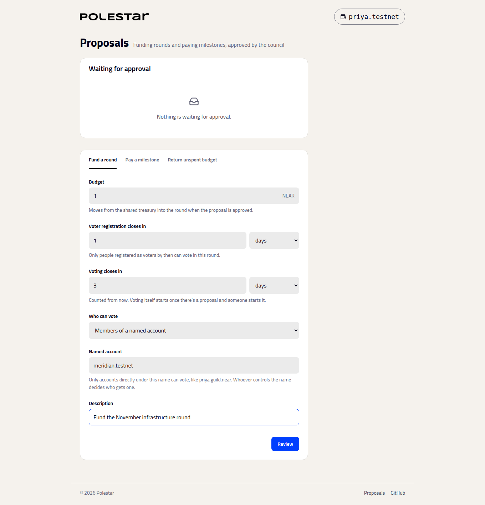
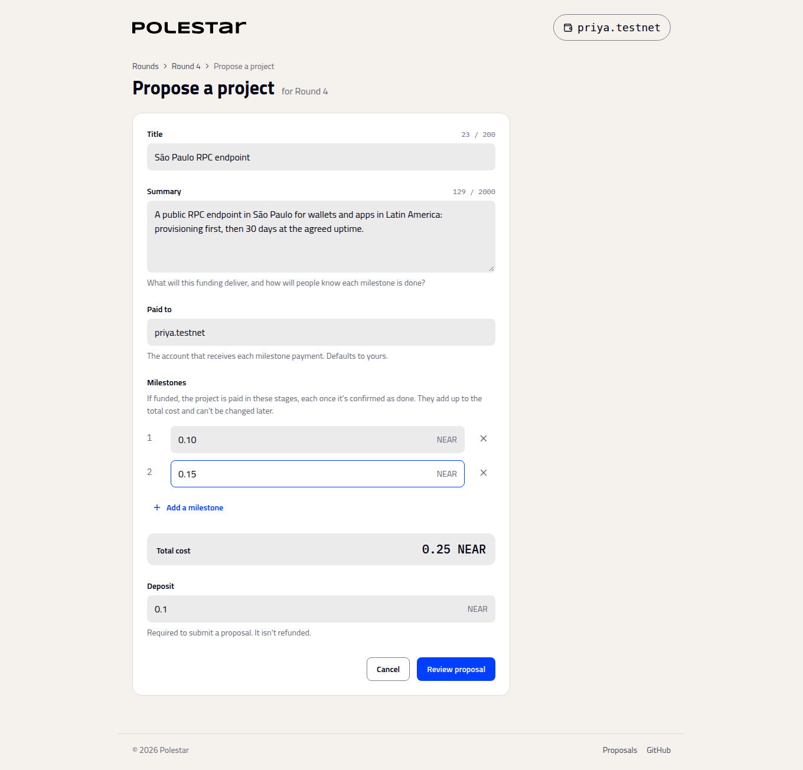
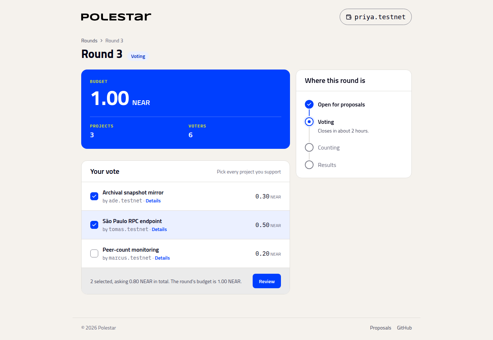
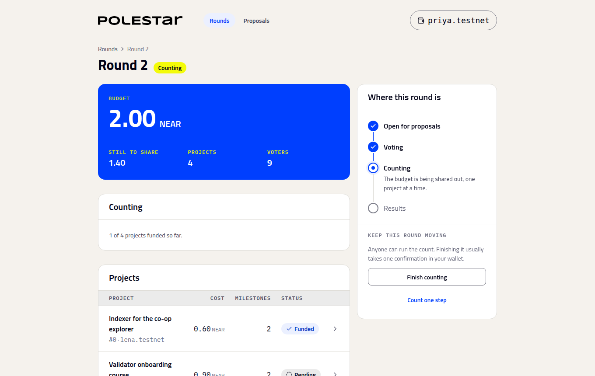

# Run a first round

_One round end to end: fund it, propose, vote, count, and pay a milestone_

This walks through a whole round in the app. You can play every role yourself by switching accounts in your wallet: a council member, a proposer, and a couple of voters.

Use short durations so you don't wait long: a few minutes for registration, a few more for voting.

## 1. Fund the round

As a council member, open **Proposals**, choose **Fund a round**, and set the budget, how long voter registration stays open, how long voting lasts, and who can vote. **Review**, then **Confirm in wallet**. The proposal appears under **Waiting for approval**. **Approve** it.



The round now appears under **Rounds**, open for proposals.

## 2. Register voters

Each voting account opens the round and chooses **Register as a voter** before registration closes. Accounts that register later can vote in later rounds, not this one.

## 3. Propose projects

On the round page, choose **Propose a project**. Enter a title, a summary, who gets paid, and the cost of each milestone.



## 4. Vote

Once there's at least one project, anyone can choose **Start voting** on the round page. Each registered voter then ticks the projects they support and confirms.



## 5. Count

When voting closes, choose **End voting**, then **Finish counting**. One wallet confirmation usually finishes the count.



## 6. Pay a milestone

As a council member, open **Proposals**, choose **Pay a milestone**, pick the project and milestone, **Review**, confirm, and approve. The payment goes to the project's recipient, and the round's results show it as paid.

If the count left budget unallocated, **Return unspent budget** sends it back to the treasury the same way.

## Check it worked

The round page shows **Results**: how much was awarded, which projects were funded, and how many milestones of each have been paid. The same data is available to any app through the [SDK](../building/sdk.md):

```bash
cd packages/sdk && npm install && npm run build
node examples/read-round.mjs --round <id>
```

## Next steps

- [Meet Polestar](../using/index.md): Each part of the app in more detail
- [How the budget is split](../using/how-the-split-works.md): Why the results came out the way they did
