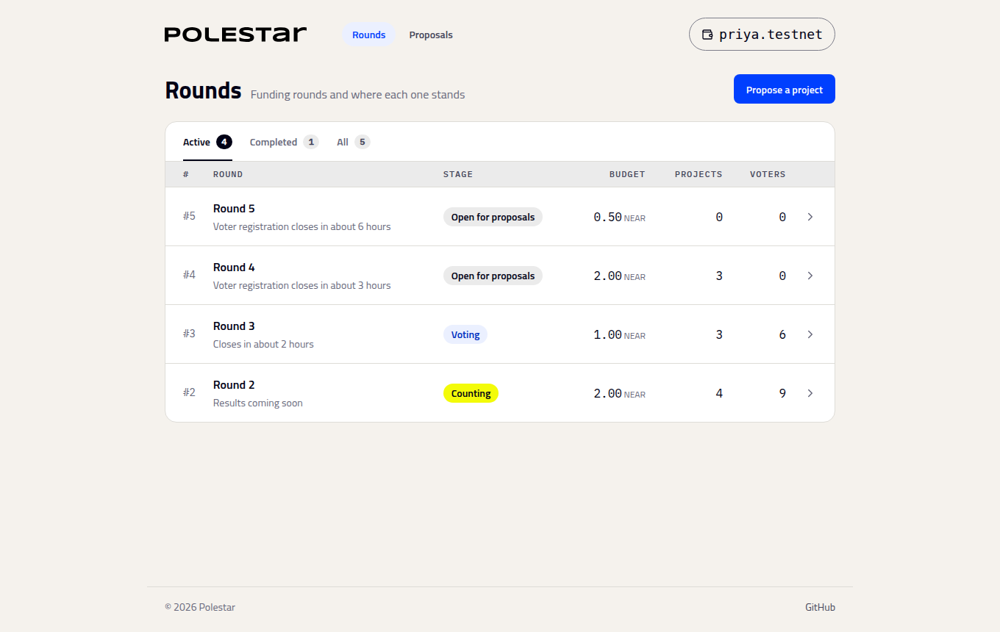

# Run the app

_Start the web app locally and connect it to a deployment_

The web app in `psui/` reads and writes the contract through the [SDK](../building/sdk.md). It needs **Node.js 20.12 or later**.

```bash
git clone https://github.com/maelstrom0x8/polestar.git
cd polestar/psui
npm install
npm run dev
```

Open http://localhost:5173. The app connects to the public deployment by default (see [Deployments](../resources/deployments.md)).



## Configure it

The app reads these at build time, from `psui/.env.local` or the environment:

| Variable | Default | What it sets |
| :-- | :-- | :-- |
| `VITE_CONTRACT_ID` | `budgeting.polestar-dev.testnet` | The Polestar contract |
| `VITE_DAO_ID` | `dao.polestar-dev.testnet` | The SputnikDAO that funds rounds and approves payments |
| `VITE_NEAR_RPC_URL` | `https://test.rpc.fastnear.com` | The NEAR RPC endpoint |

## Build for production

```bash
npm run build
```

The output in `psui/dist` is a static site. Serve it from any static host.

## Next steps

- [Deploy your own](deploy-your-own.md): A Polestar contract for your own DAO
- [Meet Polestar](../using/index.md): What each page in the app is for
