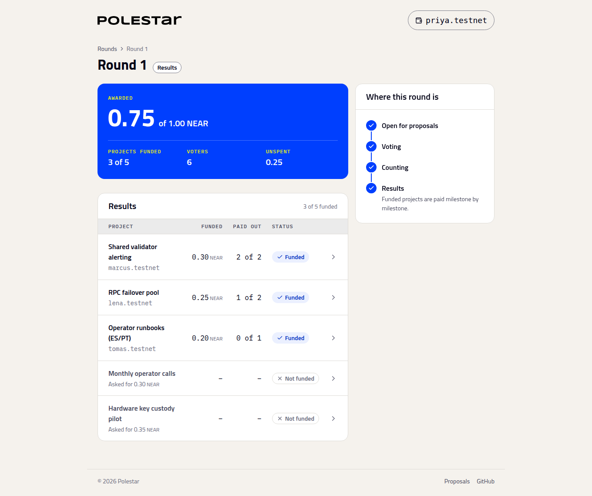
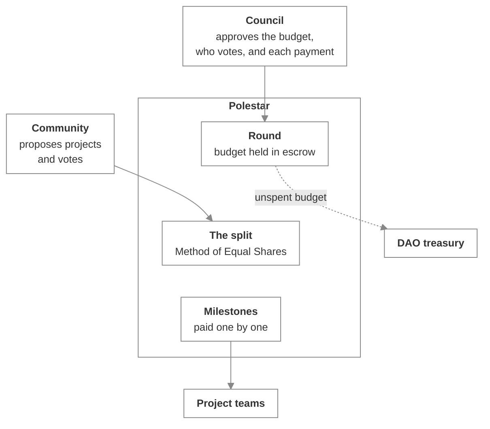

# Polestar

_Participatory budgeting for SputnikDAO treasuries: the council commits a budget, the community decides how it's shared, and funded work is paid as it's delivered_

A DAO with a shared treasury usually funds its community one request at a time. A small council reads every request, decides each one on judgement, and approves every payment separately. It works, but it doesn't scale, and the people the money is for have little say in where it goes.

Polestar changes the unit of decision from a request to a round. The council approves one budget. Members propose projects and vote for the ones they want. A published rule turns those votes into an allocation, and each funded project is paid milestone by milestone as the council confirms the work.

## The council keeps what a treasury should keep

Funding a round, deciding who may vote in it, and confirming each milestone all stay with the DAO's council. Each one is an ordinary SputnikDAO proposal, approved under the DAO's existing members and rules. Polestar never touches the DAO's membership, voting or multisig. It holds no admin key of its own and answers to one account: the DAO's.

## The community decides the split

Members approve as many projects as they like. Polestar shares the budget out with the **Method of Equal Shares**: every voter gets an equal slice, and a project is funded when the people who want it can cover its cost together. A group that is 30% of the voters tends to direct roughly 30% of the budget to the projects it agrees on, where a plain "most votes wins" rule would let the majority take everything.

The count is deterministic. The same ballots always give the same result, and anyone can run it.

## Funded work is paid as it's delivered

Every project splits its cost into milestones when it's proposed. Each milestone is paid only when the council approves a payment for it. Money the count doesn't allocate can go straight back to the treasury.

## Members-only rounds

A round can be limited to members of a community's NEAR name: only accounts like `ana.meridian.near` can vote in a `meridian.near` round. Whoever controls the name decides who's a member, so the community's own reputation system, not a free sign-up, decides who counts.

## Get started

- [Set up Polestar](getting-started/index.md) — Run the app, deploy your own instance, and take a round from funding to payout.

- [Meet Polestar](using/index.md) — You've been invited to a round. Here's what you're looking at and what you can do.

- [Build on Polestar](building/index.md) — Read rounds, run a keeper, issue members and prepare council proposals with the SDK.
