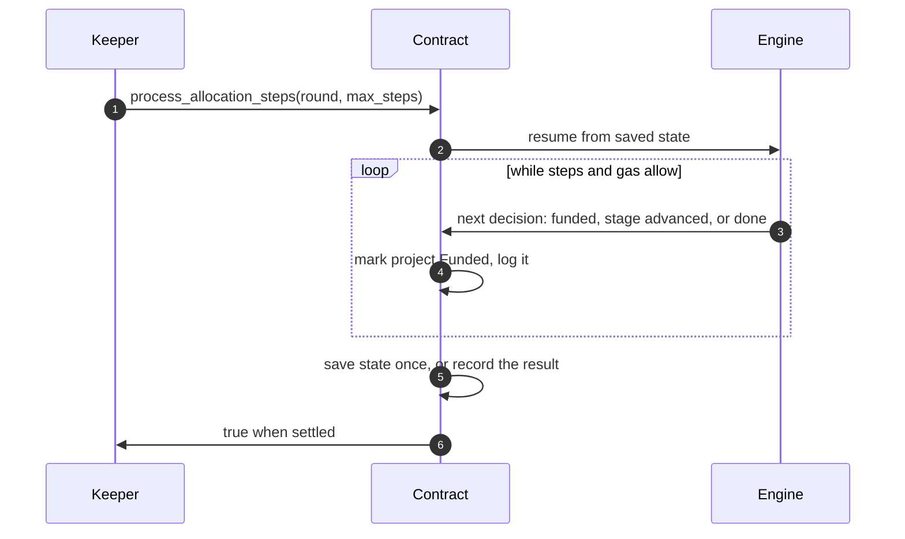

# The counting engine

_How a round's ballots become an allocation, and why the result never depends on who runs the count_

The engine lives in `crates/allocate`, a Rust library with no NEAR code. The contract feeds it a round's projects, ballots and budget, one decision at a time. The rule it implements is explained in [How the budget is split](../using/how-the-split-works.md); this page covers how it's computed.

## Two stages

| Stage | Picks next | Stops when |
| :-- | :-- | :-- |
| **Equal shares** | The project with the lowest per-supporter price: the smallest amount at which its supporters, each paying that amount or all they have left, cover its cost | No remaining project can be covered by its own supporters |
| **Completion** | Among projects that fit in the round's remaining budget, the one with the most supporters per unit of cost | No remaining project fits |

To find a project's per-supporter price, the engine sorts its supporters by how much of their share they have left and walks up the list: supporters who can't afford the current price pay everything they have, and the rest split what's still owed. The first price the remaining supporters can all afford is the answer.

Completion's stopping rule is also its guarantee: when it ends, every unfunded project costs more than what's left.

## Exact arithmetic

Every share, price and payment is an exact fraction (`crates/math`), reduced after every operation. Nothing is rounded, and every operation checks for overflow. If a fraction ever grew too large to represent, the step would fail with `ERR_RATIONAL_OVERFLOW` rather than continue with a rounded value. No round at any tested size has come close.

## Determinism

Two tie-breaks make every decision unique:

- **Among voters**, when sorting by remaining share, the lower account id comes first.
- **Among projects**, when two are equally good, the lower project id wins.

Together with exact arithmetic, the result depends only on the round's projects, ballots and budget. Ballot submission order doesn't matter; the property tests check this directly.

## One decision at a time

1. **A keeper asks for up to `max_steps` decisions.** Anyone can, at any time while the round is counting.
2. **The engine resumes.** The contract hands it the saved working state: which stage it's in, the projects still undecided, every voter's remaining share, and what's been funded so far.
3. **Decisions are made one by one.** Each is exactly the decision a fresh call would make from the same state.
4. **Funded projects are marked as they're chosen**, and each is logged as `ProjectFunded`.
5. **The loop stops** when the count finishes, after `max_steps`, or when the gas left wouldn't cover twice the heaviest decision so far plus a 30 Tgas reserve for saving.
6. **State is saved once** at the end of the call, or, on the last decision, the result is recorded and every remaining project is marked `Unfunded`.
7. **The call returns** `true` once the round has settled.

Because every call continues from exactly where the last one stopped, splitting the count across transactions, callers or batch sizes never changes the result. A property test runs random rounds one step at a time and in batches and checks the results match exactly. If a call runs out of gas anyway, NEAR reverts everything that call did, so no partial decision is ever saved.

A round can have at most 50 projects, which bounds the work any count needs. The repository's gas profile measures single steps at up to 50 projects and 500 voters.

## How it's verified

| Check | What it covers |
| :-- | :-- |
| **Reference implementation** | An independent Python version (`crates/allocate/tests/fixtures/mes_reference.py`, exact fractions) is run on a 100-voter, 6-project scenario; the Rust engine must match it decision for decision. |
| **Property tests** | Random rounds: budget conservation, no unfunded project fitting in what's left, voter shares never going negative, independence from ballot order, and batched counting matching single steps. |
| **Sandbox tests** | The compiled contract, in a local NEAR node, counts a 6-project round in one transaction and in six, with identical results. |

## Next steps

- [Funds and escrow](funds-and-escrow.md) — What happens to the money once the count is done
