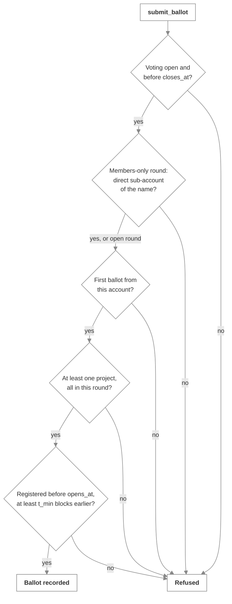

# Eligibility

_The checks every ballot goes through, and what they do and don't establish_

## Registration

Polestar keeps one value per account: the block at which it first registered, through `register_voter` or by proposing a project. It's set once and never changes. `get_first_seen(account_id)` returns it, or `null`.

## The checks on a ballot

| Check | Refusal |
| :-- | :-- |
| The round is in Declaration | `ERR_WRONG_PHASE` |
| The current block is at or before `closes_at` | `ERR_DECLARATION_CLOSED` |
| In a members-only round, the voter is a direct sub-account of the name | `ERR_NOT_IN_VOTER_NAMESPACE` |
| The account hasn't voted in this round | `ERR_ALREADY_VOTED` |
| The ballot approves at least one project | `ERR_EMPTY_APPROVAL` |
| Every approved project is in this round | `ERR_UNREGISTERED_PROJECT` |
| The account registered before `opens_at` | `ERR_NO_PRIOR_INTERACTION` |
| ...and at least `t_min` blocks before it | `ERR_ACCOUNT_TOO_NEW` |

The membership check comes before anything about the ballot or the account's history, so an outsider learns only that they can't vote in the round.

## The cutoff is a block height

`opens_at` and `t_min` are fixed when the round is funded. An account that registers after `opens_at` can't vote in that round, whatever stage the round is in, but it can vote in any round funded later with a later cutoff. The web app funds rounds with `t_min` of 0, so any registration before `opens_at` counts.

## Members-only rounds

The membership check uses NEAR's own rule for direct sub-accounts: `ana.meridian.near` is a direct sub-account of `meridian.near`; `ops.ana.meridian.near`, `meridian.near` itself and `fakemeridian.near` are not. The name is fixed when the round is funded, and the contract stores only that name, never a member list.

## What eligibility establishes

Registration shows that an account existed before a cutoff. Membership shows that the name's owner created it. Neither shows that two accounts belong to two different people. Under Equal Shares each eligible account brings its own share of the budget, so the electorate matters; members-only rounds exist to put that decision with an issuer the community already trusts. See [Issue members for members-only rounds](../building/members-only-rounds.md).

## In clients

The SDK's `voterStatus(round, accountId, firstSeen)` applies the same rules to predict whether an account can vote, and the app uses it to show "You're registered" or "You can't vote in this round". It's a prediction for display. The contract decides.

## Next steps

- [Vote](../using/vote.md): The same rules, from the voter's side
