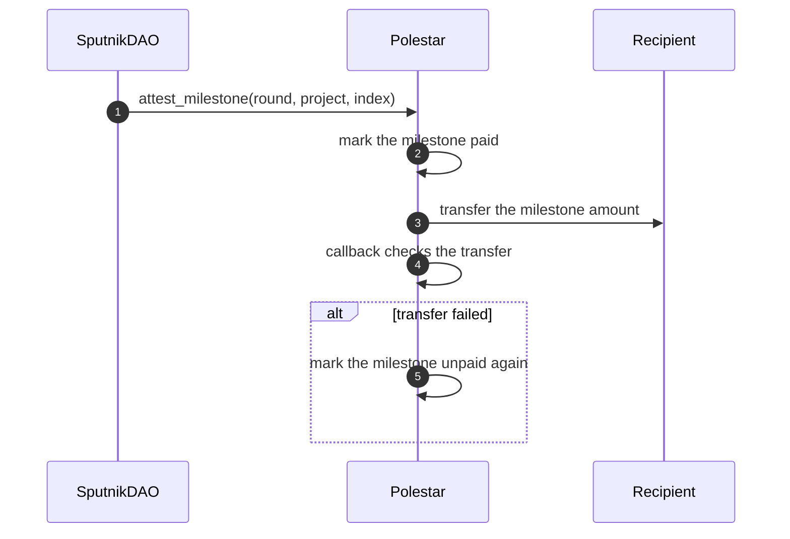

# Funds and escrow

_Where each round's money is at every point, and how it leaves the contract_

A round's budget arrives with `fund_round` and stays in the contract until it's paid to a project or returned to the DAO.

## Accounting per round

| Moment | Where the round's money is |
| :-- | :-- |
| Funded | All of it in `remaining` |
| During counting | Each funded project's cost moves from `remaining` into that project's milestones |
| Settled | Unpaid milestones of funded projects, plus `remaining` |
| After payments and a return | Only milestones not yet paid |

At every point, the budget equals `remaining` plus the cost of every funded project. Counting only ever moves money between those two; it never creates or loses any.

## A milestone payment

1. **The DAO calls `attest_milestone`.** The round must be settled, the project funded, and the milestone unpaid.
2. **The milestone is marked paid first.** A second call for the same milestone fails at once, even while the first transfer is still in flight.
3. **The amount is sent** to the project's recipient.
4. **A callback checks the result.** It's private: only the contract itself can call it.
5. **A failed transfer is undone.** The milestone is marked unpaid, `MilestoneReleaseFailed` is logged, and a later proposal can pay it.

`return_remaining` follows the same pattern: it records the return, sends `remaining` to the DAO, and undoes the record if the transfer fails. Before sending, it also checks that the contract's balance, minus what it must keep for storage, covers the amount. `remaining` itself is never overwritten; a separate record marks it returned.

## The contract's own balance

Every NEAR account locks part of its balance to pay for the storage it uses. Polestar's code, rounds, projects, ballots and registrations all use storage, and the contract pays for it from the same balance that holds round budgets. The project deposit is kept by the contract, but isn't sized to the storage a project uses, and registering or voting carries no deposit.

So a deployment's operator keeps a reserve on the contract account and tops it up as it grows. If the balance ever fell short, a milestone transfer would fail and be undone, leaving the milestone unpaid but payable once the balance is restored.

## What the council can't do

The DAO can only call the three operations above. It can't move a funded project's money to anyone else, return it to the treasury, or pay more than a milestone's amount. A milestone it never approves stays in the contract.

## Next steps

- [Pay milestones and return unspent budget](../using/pay-milestones.md) — The same flow, from the council's side in the app
