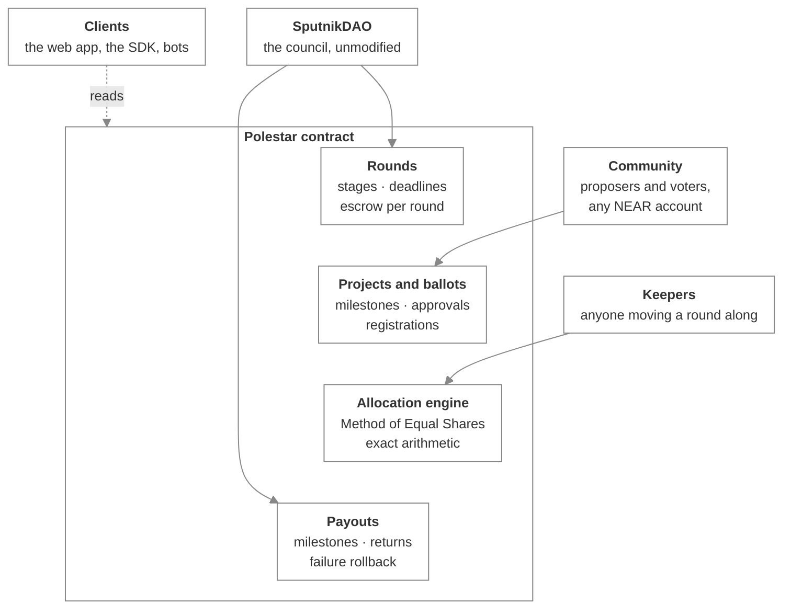

# How Polestar is built

_The components of Polestar, what each is responsible for, and how they connect_

Polestar is one NEAR contract, an allocation engine it embeds, and the clients around it. This section covers the parts of the design that aren't obvious from the outside. Read it if you're integrating at the contract level, reviewing the code, or working on Polestar itself.

## Components

| Component | Responsibility |
| :-- | :-- |
| **Rounds** | Each round's configuration, stage, and the budget it holds. Rounds are independent and never deleted. |
| **Projects and ballots** | Proposals with their fixed milestone schedules, ballots, and each account's registration block. |
| **Allocation engine** | Turns a round's projects, ballots and budget into an allocation. A pure Rust library with no NEAR code, used by the contract one step at a time. |
| **Payouts** | Milestone payments to recipients and returns of unspent budget to the DAO, each undone if its transfer fails. |
| **SputnikDAO** | The only account allowed to fund rounds, pay milestones and return unspent budget. Polestar never calls it. |
| **Clients** | The web app and the SDK. They hold no state of their own beyond what the browser remembers for convenience. |

## Who can call what

| Group | Methods | Caller |
| :-- | :-- | :-- |
| **DAO operations** | `fund_round`, `attest_milestone`, `return_remaining` | Only the configured SputnikDAO account |
| **Community** | `register_project`, `register_voter`, `submit_ballot` | Any account, subject to the round's stage and eligibility |
| **Keeping rounds moving** | `open_declaration`, `close_declaration`, `process_allocation_step(s)` | Anyone, gated only by stage and block height |

There's no admin role. The DAO check compares the caller with the configured account inside the same call it protects, so there's nothing to go stale between checking and acting.

## Next steps

- [Life of a round](life-of-a-round.md) — One round traced from funding to its last payment
- [The counting engine](counting-engine.md) — How the allocation is computed and why it's reproducible
