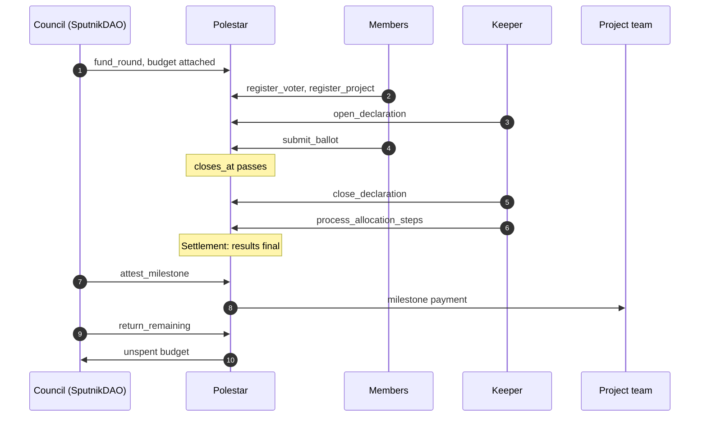
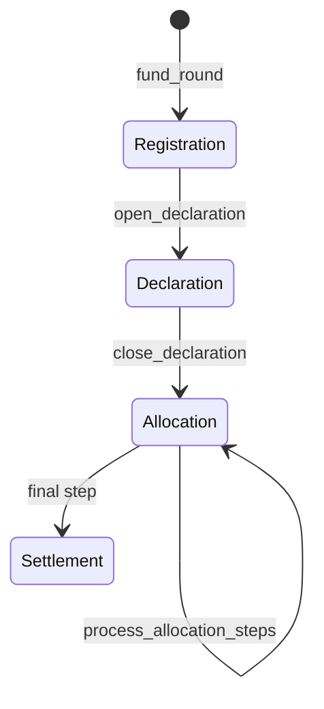

# Life of a round

_One round traced from funding to its last payment, with the call responsible for each step_

1. **The council funds the round.** An approved proposal makes the DAO call `fund_round` with the budget attached. The round starts in **Registration** with `remaining` equal to the budget, and its deadlines and electorate are fixed. See [Fund a round](../using/fund-a-round.md).
2. **Members register and propose.** `register_voter` records each account's registration block, once. `register_project` adds a project with its milestones and registers the proposer too.
3. **Someone starts voting.** `open_declaration` needs at least one project. The round moves to **Declaration** and stops taking proposals.
4. **Members vote.** `submit_ballot` records each eligible account's approvals, once, until `closes_at`. See [Eligibility](eligibility.md).
5. **Voting closes.** Nothing happens on chain at `closes_at` itself. From the next block, ending voting becomes possible.
6. **Someone ends voting.** `close_declaration` freezes the ballots, sets up the count's working state, and moves the round to **Allocation**.
7. **Someone runs the count.** `process_allocation_steps` funds projects one decision at a time, saving progress between calls, until every decision is made. See [The counting engine](counting-engine.md).
8. **The round settles.** The last step records the result, marks every project **Funded** or **Unfunded**, and moves the round to **Settlement**. Nothing about the allocation can change after this.
9. **The council approves a payment.** An approved proposal makes the DAO call `attest_milestone` for one milestone of a funded project.
10. **The team is paid.** The milestone is marked paid and its amount is sent to the recipient. If the transfer fails, it's marked unpaid again. See [Funds and escrow](funds-and-escrow.md).
11. **The council takes back the leftover.** An approved `return_remaining` sends what the count didn't allocate back to the DAO.
12. **The treasury receives it.** Funded projects' milestones remain payable.

## Stages

Stages only move forward. The app labels them **Open for proposals**, **Voting**, **Counting** and **Results**.

## Rounds side by side

Each round has its own id, stage, budget, projects and ballots. One round can be counting while another takes proposals and a third pays milestones. Registrations are shared: an account registered once counts for every round whose cutoff comes after it.

## Next steps

- [The counting engine](counting-engine.md): Step 7 in detail
- [Funds and escrow](funds-and-escrow.md): Steps 9 to 12 in detail
