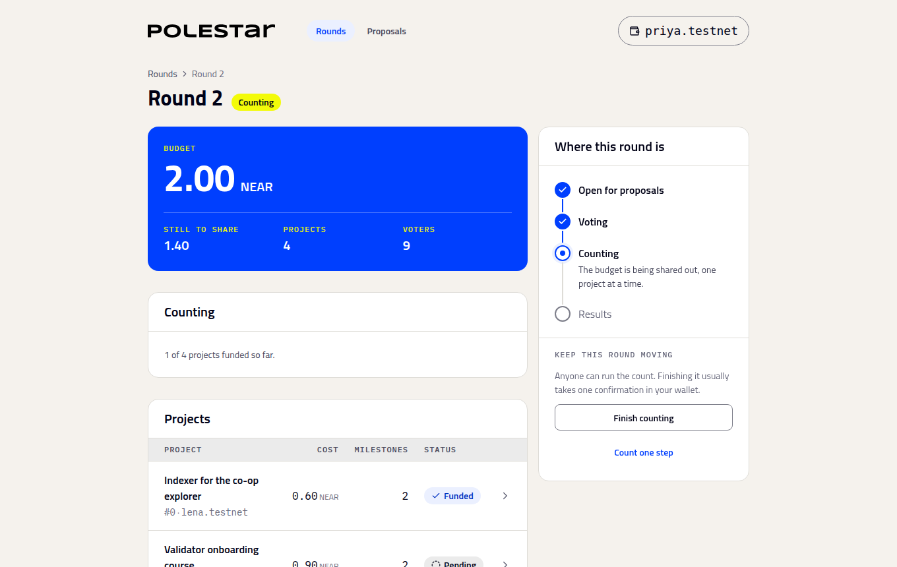
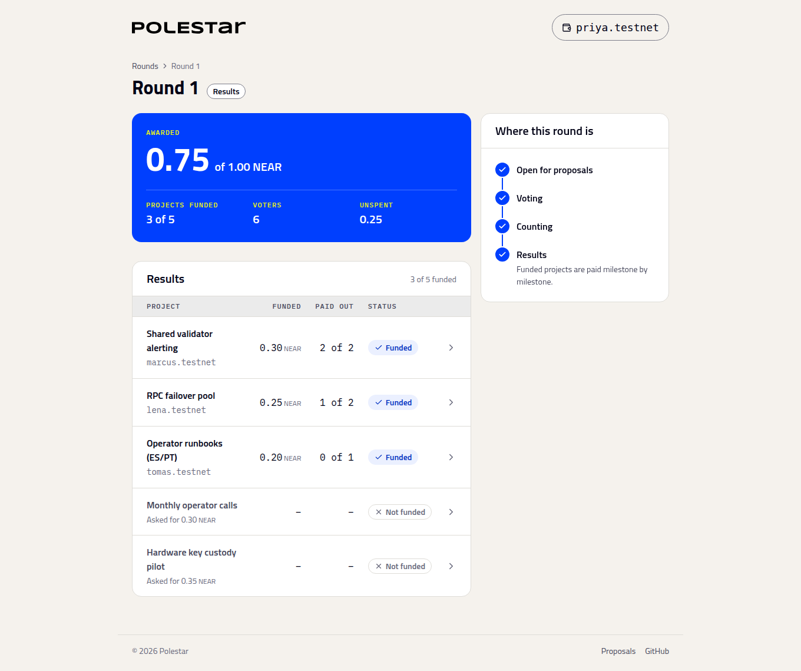

# Count and read the results

_Ending voting, running the count, and what the results page tells you_

## Run the count

When voting has closed, the round page shows **End voting** under **Keep this round moving**. Anyone can press it. The round moves to **Counting**, and **Finish counting** appears.

One confirmation usually finishes the count. A very large round may need a second. There's no deposit, only the network fee, and it doesn't matter who runs it: the result is the same whoever does.

**Count one step** runs a single decision at a time, if you want to watch the count unfold. Each decision appears in the log as it happens: "Shared validator alerting funded", "Hardware key custody not funded".

## Read the results

| Part | What it shows |
| :-- | :-- |
| **Awarded** | How much of the budget went to funded projects |
| **Projects funded** | How many of the round's projects were funded |
| **Unspent** | What the count left unallocated. It changes to **Returned to the treasury** once the council takes it back. |
| **Results** table | Each project, what it was awarded, how many milestones have been paid, and whether it was funded |

Results are final. A project's **Funded** or **Not funded** status never changes, and funded amounts can't be moved to another project.

## Why a project wasn't funded

A project goes unfunded when its supporters couldn't cover its cost from their shares and there wasn't enough left over afterwards to fund it anyway. It doesn't mean it had the fewest votes. See [How the budget is split](how-the-split-works.md) for a worked example.

## Next steps

- [Pay milestones and return unspent budget](pay-milestones.md): What the council does next
- [The counting engine](../internals/counting-engine.md): How the count runs across transactions
