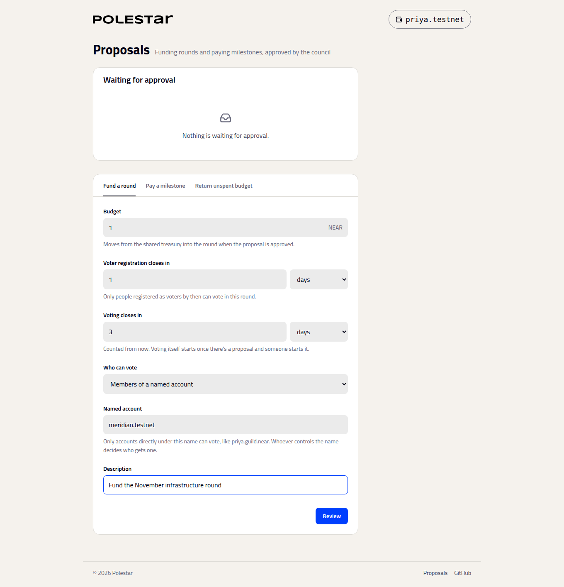

# Fund a round

_How the council creates a round, and the choices it makes when it does_

Funding a round moves its budget from the DAO's treasury into Polestar. Only the DAO can do it, so it's always a proposal the council approves.

## Fill in the round

Open **Proposals** and choose **Fund a round**.

| Field | What it decides |
| :-- | :-- |
| **Budget** | How much moves into the round when the proposal is approved |
| **Voter registration closes in** | How long people have to register as voters. Only accounts registered by then can vote in this round. |
| **Voting closes in** | How long until voting can be ended, counted from now |
| **Who can vote** | **Members of a named account** (the default): only accounts directly under that name, such as `ana.meridian.near` for `meridian.near`. Or **Anyone who registers**. |
| **Description** | What council members see when they approve it |

**Review** shows everything you're about to propose, including the bond. **Confirm in wallet** submits the proposal.

**Note**

The durations become fixed block heights when you review the proposal, using the chain's measured block time. However long approval takes, the deadlines don't move, so leave room for it.

## Approve it

The proposal appears under **Waiting for approval** for every council member, with **Approve** and **Reject**. When enough of the council approves, the DAO funds the round and the bond is refunded. The new round appears under **Rounds**.

These are ordinary SputnikDAO proposals, so any SputnikDAO interface can show and approve them too.

## What can't change afterwards

A round's budget, deadlines and electorate are fixed when it's funded. The council can't add or remove projects or ballots, change the count, or move a funded project's money elsewhere. What it keeps is control over when, and whether, each milestone is paid.

## Running rounds side by side

Each funded round is independent. A DAO can open November's round while October's is still paying milestones.

## Next steps

- [Pay milestones and return unspent budget](pay-milestones.md) — The council's job after the count
- [Issue members for members-only rounds](../building/members-only-rounds.md) — Giving members accounts under your name
