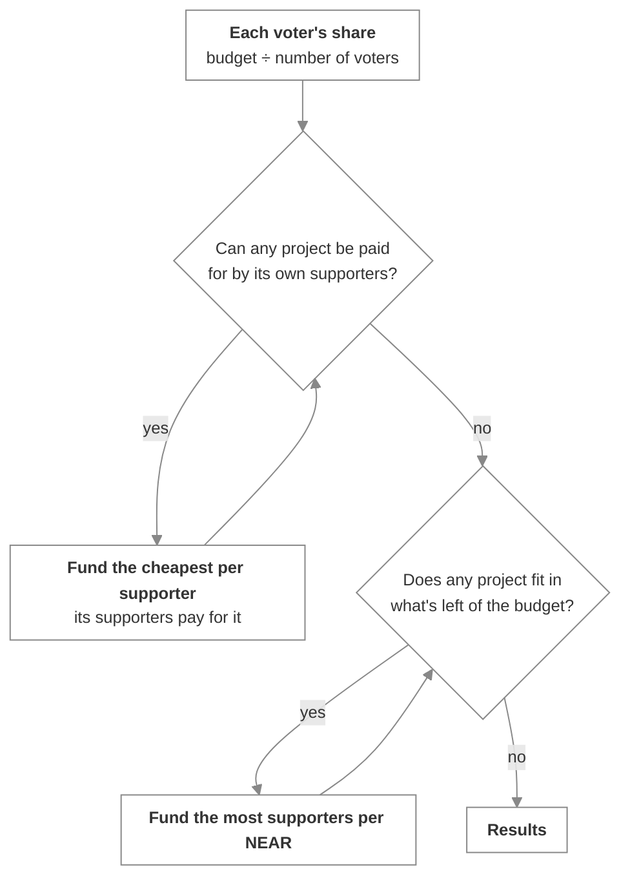

# How the budget is split

_The Method of Equal Shares, in plain terms, with a worked example_

Polestar shares a round's budget out with the **Method of Equal Shares**, a rule from participatory budgeting research. It answers a specific question: when one fixed budget has to be divided between many competing projects, how do you make sure every group of voters gets a fair part of it?

## The rule

**Everyone gets an equal share.** The budget is divided equally between everyone who voted.

**Projects are bought by the people who want them.** A project can be funded when its supporters can pay its cost together from their shares. When several projects could be funded, the one that's cheapest per supporter goes first. Its supporters pay for it, split as evenly as their remaining shares allow, and the process repeats.

**What's left over is still spent.** When no remaining project can be paid for by its own supporters, some budget is usually still unspent. Polestar then funds, among the projects that still fit, the one with the most supporters per NEAR of cost, and repeats until nothing fits.

When the count ends, every unfunded project costs more than what's left. No budget sits idle that could have paid for one more project.

## A worked example

A round has 10 NEAR and 10 voters. Six approve projects A and B. Four approve only C.

| Project | Cost | Supporters |
| :-- | :-- | :-- |
| A | 5 NEAR | 6 |
| B | 5 NEAR | 6 |
| C | 4 NEAR | 4 |

**With a plain vote**, the most-approved projects win: A and B, with six votes each, use the whole 10 NEAR. The four voters who wanted C get nothing.

**With Equal Shares**, each voter's share is 1 NEAR.

1. A would cost each of its 6 supporters about 0.83 NEAR. So would B. C would cost each of its 4 supporters 1 NEAR. A and B are cheapest per supporter and tie, so the lower-numbered one goes first: **A is funded**. Its six supporters have about 0.17 NEAR left each.
2. B needs 5 NEAR, but its supporters now hold 1 NEAR between them. C's supporters can still pay 1 NEAR each: **C is funded**.
3. Nothing else can be paid for by its supporters, and B's 5 NEAR doesn't fit in the 1 NEAR left. The count ends.

A and C are funded, B isn't, and 1 NEAR is left for the treasury. The six voters directed 5 NEAR and the four voters directed 4. This example is checked against the repository's independent reference implementation.

## What it means for you

- **Proposers:** you need enough supporters to cover your cost, not the most votes in the round.
- **Voters:** approve every project you'd want funded. A group of voters who agree tends to get funding roughly in line with its size.
- **Councils:** results you can explain. Every allocation can be recomputed by anyone from the public ballots.

## What it doesn't do

The rule is proportional to whoever votes. It can't tell whether two accounts belong to one person, and it isn't designed to resist strategic voting. Who may vote is decided separately, by registration and, for members-only rounds, by the community's own NEAR name. See [Eligibility](../internals/eligibility.md).

## Next steps

- [The counting engine](../internals/counting-engine.md) — Ties, exact arithmetic, and running the count in steps
