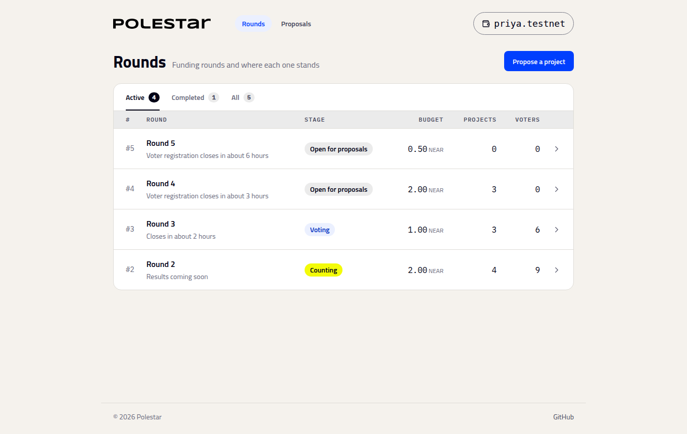

# Meet Polestar

_What a round is, what each page shows, and what you can do on it_

Everything in Polestar happens in a **round**: one budget, the projects proposed for it, the votes cast, and the payments that follow. Rounds are public. Anyone can read them without signing in.

## The rounds list

**Rounds** shows every round, its stage, its budget, and how many projects and voters it has. **Active** holds the rounds still taking proposals, voting or counting; **Completed** holds the ones with results.

## Getting around

The header has the two places you'll use most: **Rounds**, for every round and its projects and results, and **Proposals**, where the council funds rounds and pays milestones. Once you've signed in, the Polestar logo takes you to **Rounds** too.

## A round's stages

A round moves through four stages, always in this order:

| Stage | What happens | Who acts |
| :-- | :-- | :-- |
| **Open for proposals** | Members propose projects. Voters register. | Proposers, voters |
| **Voting** | Registered voters approve the projects they support. | Voters |
| **Counting** | The ballots are turned into an allocation. | Anyone |
| **Results** | Funded projects are paid milestone by milestone. | The council |

The panel on the right of every round page, **Where this round is**, shows the current stage and what has to happen next. When a step can be taken by anyone, such as starting or ending voting, its button is there under **Keep this round moving**.

## What you can do depends on who you are

| You are | You can |
| :-- | :-- |
| **Anyone** | Read every round, project and result. Start voting, end it, and run the count when the time comes. |
| **A proposer** | Propose projects while a round is open. See [Propose a project](propose-a-project.md). |
| **A voter** | Register, then vote in rounds you're eligible for. See [Vote](vote.md). |
| **A council member** | Fund rounds, pay milestones, return unspent budget, and approve other members' proposals. See [Fund a round](fund-a-round.md). |

## Signing in

**Sign in** in the header opens the wallet choice. Polestar never holds your keys; every action is a transaction your wallet shows you before you sign. Each transaction screen in the app shows what the action does and the deposit, if any, before your wallet opens.

## Next steps

- [Vote](vote.md) — Registering, eligibility, and casting a ballot
- [How the budget is split](how-the-split-works.md) — How votes become an allocation
