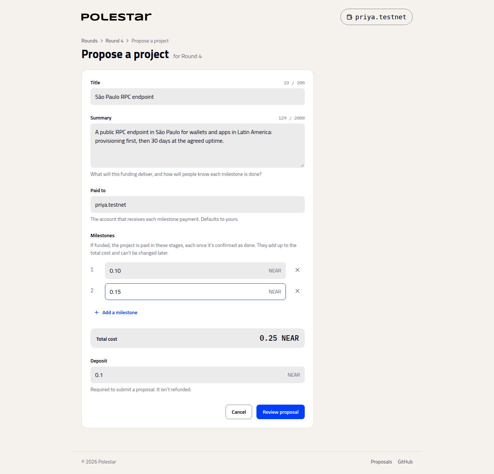

# Propose a project

_Asking a round for funding, and how milestones work_

Any NEAR account can propose a project while a round is open for proposals. On the round page, choose **Propose a project**.

| Field | Rule |
| :-- | :-- |
| **Title** | Up to 200 bytes |
| **Summary** | What you'll deliver, up to 2,000 bytes |
| **Paid to** | The account milestone payments go to. It doesn't have to be yours. |
| **Milestones** | The cost split into deliverable parts, in order. Their total is the project's cost. |
| **Deposit** | A small deposit kept by the contract, 0.05 NEAR by default |

Proposing also registers you as a voter. The app keeps your draft if you have to sign in midway.

## Writing good milestones

Milestones are fixed once you propose, and each is paid separately when the council approves it. Make each one a piece of work the council can check, with the amount it costs:

- **Specific.** "Endpoint live and serving traffic" rather than "phase 1".
- **Checkable.** Something the council can see: a URL, a report, a release.
- **Ordered.** Payments can be made in any order, but councils usually expect them in sequence.

## How a project gets funded

Under the Method of Equal Shares, what matters is that enough voters want your project to cover its cost from their shares, not that it out-polls every other project. A smaller project with a committed group behind it can be funded while a more popular, more expensive one isn't. See [How the budget is split](how-the-split-works.md).

## Limits

A round takes at most 50 projects. Projects can't be edited or withdrawn; to correct one, propose it again while the round is open.

## Next steps

- [Vote](vote.md) — What happens once proposals close
- [Pay milestones and return unspent budget](pay-milestones.md) — Getting paid after the count
