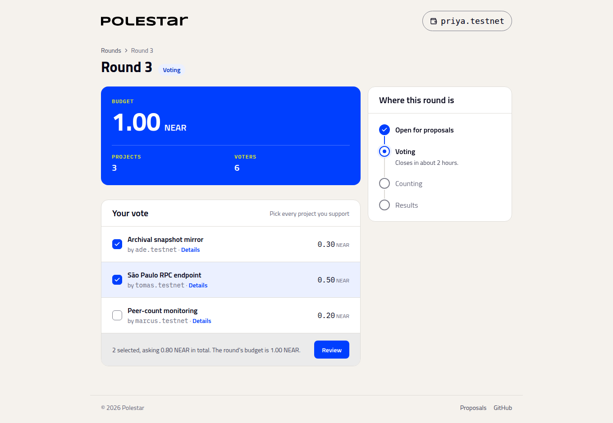

# Vote

_Registering in time, members-only rounds, and casting a ballot_

## Register before the cutoff

Every round has a voter-registration cutoff, set by the council when it funded the round. Only accounts registered before it can vote. Registering is a one-time step: choose **Register as a voter** on any round page. It costs only the network fee and covers every round funded after it.

The round page tells you where you stand:

| What you see | What it means |
| :-- | :-- |
| **Want to vote in this round?** with a register button | You aren't registered and the cutoff hasn't passed. Register now. |
| **You're registered** | You'll be able to vote once voting starts. |
| **You can't vote in this round** | You registered after the cutoff, or the round is members-only and you aren't a member. You can still follow the results. |

**Tip**

Proposing a project also registers you, so proposers are already set.

## Members-only rounds

A round can be limited to members of a community's NEAR name. In a `meridian.near` round, only accounts named like `ana.meridian.near` can vote. The round page shows **Who can vote: Members of meridian.near**.

Membership means an account directly under the name: `ana.meridian.near` counts, `ana.ops.meridian.near` and `meridian.near` itself don't. Only whoever controls `meridian.near` can create accounts under it, so they decide who's a member.

## Cast your ballot

When voting starts, the round page shows **Your vote**. Tick every project you support and choose **Review**. The summary shows how many you picked and what they ask for in total. **Confirm in wallet** casts it.

- **Approve every project you'd want funded.** There's no ranking. Your share of the budget can go to any project you approve.
- **Supporting a smaller project isn't wasted.** Under a plain vote it rarely changes anything. Under Equal Shares, a group of voters who agree on some projects tends to fund them roughly in proportion to its size.
- **Your ballot is final and public.** It can't be changed once cast, and anyone can read it.

## When voting ends

Voting can be ended once its closing time passes. Anyone can do it, from the round page. Then the count runs: see [Count and read the results](count-and-results.md).

## Next steps

- [How the budget is split](how-the-split-works.md) — What your ballot does in the count
- [Eligibility](../internals/eligibility.md) — The exact rules the contract applies
